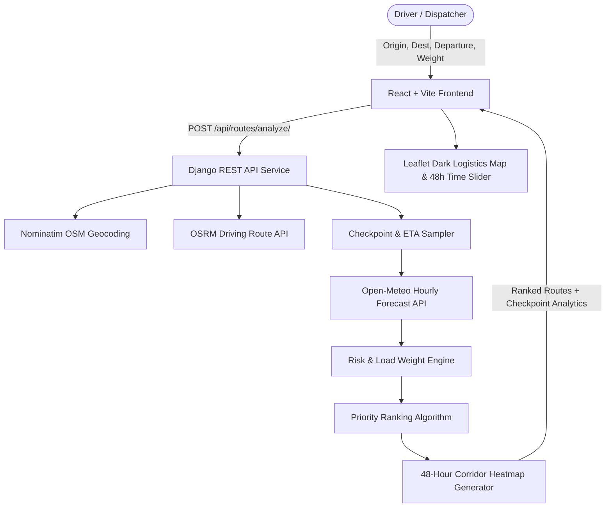

# 🚛 Spotter — Weather-Aware Truck Routing Engine

> Built for the **Spotter Full Stack Developer Assessment**. A full-stack web application combining **Django REST Framework** and **React** that empowers freight truck drivers and fleet managers to identify the safest highway corridors based on localized real-time weather forecasts, truck cargo weight, and travel durations.

---

## 🌟 Key Features

1. **Multi-Route Generation**: Fetches **3 distinct alternate routes** between any origin and destination across North America using highway routing networks.
2. **Dynamic Checkpoint Sampling**: Slices route geometry into equidistant checkpoints (every **10, 25, or 50 miles**).
3. **Time-Aware Forecast Matching**: Computes the truck's exact **Estimated Arrival Time (ETA)** at every checkpoint and matches it to that hour's weather forecast.
4. **Exact Risk Classification & Load Rules**: Evaluates crosswinds, rainfall intensity, and snowfall against safety thresholds, escalating wind risks based on vehicle cargo weight.
5. **Algorithmic Route Recommendation**: Evaluates and ranks candidate routes based on a 4-tier safety hierarchy:
   - Priority 1: Fewest Severe & No-Travel miles
   - Priority 2: Fewest High-risk miles
   - Priority 3: Lowest average composite risk
   - Priority 4: Shortest travel time
6. **Corridor Heatmap & 0–48h Time Scrubber**: Interactive Leaflet map with smooth time-scrubbing slider and auto-animation to track moving storms across 48 hours.

---

## 📐 System Architecture



---

## 🛡️ Risk Rules & Weight Escalation Matrix

### 1. Baseline Weather Thresholds

| Condition | Low | Moderate | High | Severe | No Travel |
| :--- | :--- | :--- | :--- | :--- | :--- |
| **Wind** | `< 25 mph` | `25–34 mph` | `35–44 mph` | `45–54 mph` | `≥ 55 mph` |
| **Rain** | `< 0.10 in/hr` | `0.10–0.25 in/hr` | `0.25–0.50 in/hr` | `0.50–1.00 in/hr` | `> 1.00 in/hr` |
| **Snow** | `< 0.5 in/hr` | `0.5–1.0 in/hr` | `1.0–2.0 in/hr` | `2.0–3.0 in/hr` | `> 3.0 in/hr` |

### 2. Truck Load Rules (Weight Impact on Wind)
* **Wind $\ge$ 55 mph** $\rightarrow$ **No Travel** for all loads.
* **Wind 45–54 mph AND Weight > 30,000 lbs** $\rightarrow$ Escalates from Severe to **No Travel**.
* **Wind 35–44 mph AND Weight > 40,000 lbs** $\rightarrow$ Escalates from High to **Severe**.

---

## 🚀 Quickstart & Local Setup

### Prerequisites
- **Python 3.9+**
- **Node.js 18+** & npm
- **Git**

---

### Step 1: Clone & Initialize Git

```bash
git init
git add .
git commit -m "feat: complete spotter weather-aware truck routing engine"
```

---

### Step 2: Backend Setup (Django REST Framework)

```bash
cd backend

# Create virtual environment
python -m venv venv

# Activate virtual environment
# Windows (PowerShell):
.\venv\Scripts\Activate.ps1
# Mac/Linux:
source venv/bin/activate

# Install dependencies
pip install -r requirements.txt

# Run database migrations
python manage.py migrate

# Run unit tests to verify logic correctness
python manage.py test routing

# Start backend server (runs on port 8000)
python manage.py runserver
```

---

### Step 3: Frontend Setup (React + Vite)

In a new terminal window:

```bash
cd frontend

# Install npm packages
npm install

# Start Vite dev server (runs on port 5173 with proxy to port 8000)
npm run dev
```

Open `http://localhost:5173/` in your browser.

---

## 🧪 Automated Unit Tests

All risk thresholds and recommendation sorting criteria are covered with automated unit tests in `backend/routing/tests/test_risk_engine.py`.

Run tests:
```bash
python manage.py test routing
```

**Test Coverage Highlights:**
- `test_wind_classification`: Validates all boundary conditions for wind (<25, 25-34, 35-44, 45-54, >=55).
- `test_rain_classification`: Validates precipitation rates (<0.10, 0.10-0.25, 0.25-0.50, 0.50-1.00, >1.00).
- `test_snow_classification`: Validates snowfall rates (<0.5, 0.5-1.0, 1.0-2.0, 2.0-3.0, >3.0).
- `test_load_rules_escalation`: Validates escalation to No Travel for >30k lbs and to Severe for >40k lbs.
- `test_ranking_priority`: Validates strict preference ordering (Severe miles $\rightarrow$ High miles $\rightarrow$ Average risk $\rightarrow$ Duration).

---

## 📡 API Reference

### `POST /api/routes/analyze/`
Analyzes candidate routes and corridor weather.

**Request Body:**
```json
{
  "origin": "Chicago, IL",
  "destination": "Dallas, TX",
  "departure_time": "2026-10-17T12:00:00Z",
  "load_weight_lbs": 35000,
  "sample_interval_miles": 25
}
```

**Response Format:**
```json
{
  "query": { "origin": {...}, "destination": {...}, "load_weight_lbs": 35000 },
  "routes": [
    {
      "id": "route_1",
      "name": "Route Option 1 (Direct / Highway)",
      "is_recommended": true,
      "rank": 1,
      "distance_miles": 925.4,
      "duration_hours": 14.5,
      "metrics": {
        "severe_miles": 0.0,
        "high_miles": 25.0,
        "average_risk_score": 1.85
      },
      "checkpoints": [...]
    }
  ],
  "corridor_heatmap": {
    "num_hours": 48,
    "timestamps": [...],
    "hours_data": { "0": [...], "1": [...] }
  }
}
```

---

## ☁️ Deployment Guide

### Backend on Render / Railway
1. Push to GitHub.
2. Link repo to [Render](https://render.com) as a **Web Service**.
3. Build Command: `pip install -r backend/requirements.txt && python backend/manage.py migrate`
4. Start Command: `gunicorn --chdir backend core.wsgi:application`

### Frontend on Vercel / Netlify
1. Link the same repository.
2. Root Directory: `frontend`
3. Build Command: `npm run build`
4. Output Directory: `dist`
5. Configure environment variable or rewrite for `/api` pointing to your deployed backend URL.

---

## 📹 Loom Walkthrough Structure (5–10 min)

When recording your video walkthrough for Spotter:
1. **0:00–1:00 | Introduction**: State your name, role, and summarize the goal of the application.
2. **1:00–3:00 | Live Demo**:
   - Demonstrate entering Origin/Destination (e.g. Chicago to Dallas).
   - Change the **Load Weight slider** (e.g., from 20,000 lbs to 45,000 lbs) to demonstrate how the weight escalation rule triggers higher risk levels on high wind checkpoints.
   - Show the 3 alternate routes and why Route #1 was selected as Recommended.
3. **3:00–4:30 | Corridor Heatmap & 48h Slider**:
   - Click "Animate" or scrub the 0–48 hour forecast slider to show corridor weather shifting across time.
4. **4:30–6:00 | Code Quality & Unit Tests**:
   - Open `backend/routing/services/risk_engine.py` and explain the modular architecture.
   - Run `python manage.py test routing` in the terminal to show 100% passing test assertions.
